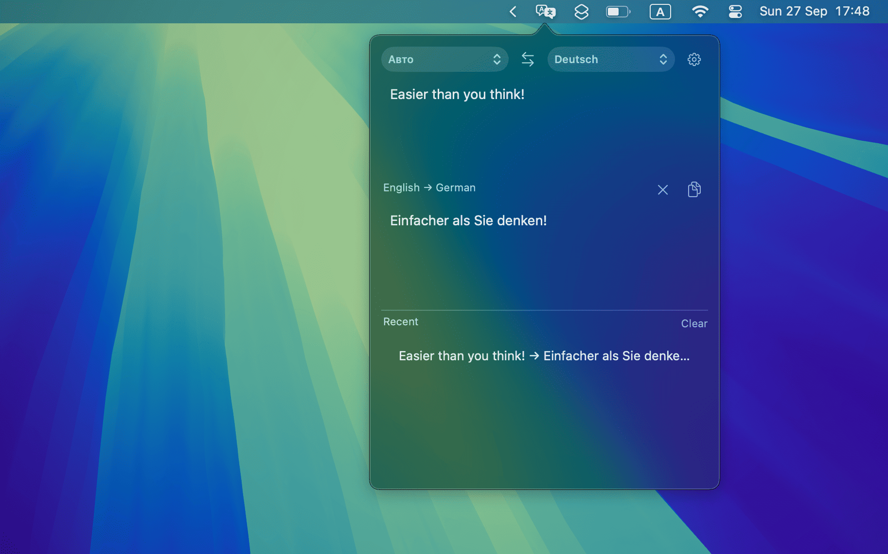

# Translate Bar

**Easier than you think!**

A minimalist menu bar translator for macOS. Click the icon, type, get the translation — no windows in the Dock, no clutter.



## Features

- [PopClip integration](#popclip-integration) — translate selected text from any app
- Lives in the menu bar (no Dock icon)
- 12 target languages, source language detection or manual selection with one-click swap
- One-click translation history with reuse
- Interface in 6 languages, follows the system language by default
- Built-in updates: checks GitHub once a day, installs with one click
- Free, no API keys, translation history stored locally on your Mac

## Requirements

- macOS 13 Ventura or later
- Apple Silicon or Intel (universal binary)
- Internet connection (translations use Google / MyMemory online services)

## Install

1. Download `TranslateBar-1.3.0-universal.dmg` from the [Releases](../../releases) page.
2. Open it and drag **Translate Bar.app** into **Applications**.
3. Launch it. On the first run macOS will warn about an unsigned developer — right-click the app → **Open** to confirm.

## PopClip integration

Select text in any app → **Translate Bar** action in PopClip → the text opens in Translate Bar and gets translated automatically.

1. Download `TranslateBar.popclipextz` from the [Releases](../../releases) page (available since v1.1.0).
2. Double-click it to install into PopClip.
3. Requires Translate Bar 1.1.0+.

## Updates

Translate Bar checks the [Releases](../../releases) page once every 24 hours and
shows a banner in the popover when a newer version is available. Nothing is
downloaded or installed without an explicit click:

1. A banner at the bottom of the popover reads **Version X is available** with an
   **Install** button and a **×** to skip that version.
2. **Install** downloads the DMG to
   `~/Library/Application Support/Translate Bar/updates/`, verifies it against the
   SHA-256 published by GitHub, mounts it and checks the bundle identifier and
   version inside.
3. The app quits, a small helper waits for the process to exit, replaces the
   bundle in place, removes the quarantine flag, detaches the image and launches
   the new version. The DMG is deleted afterwards.

When the app runs from source (or lives outside `/Applications`), the same
banner offers **Open DMG** instead: the image is opened in Finder and you install
it manually.

Updates can also be checked from the icon's context menu (the item reads
**Update X Available** once found) or from **Settings → Check for Updates**, where
the automatic check can be turned off. The GitHub API used for the check is free
and unauthenticated — 60 requests per hour per IP, of which we need at most one
per day.

## Privacy

No accounts, no tracking, no API keys. Translation requests go to public translation services; history and settings live only in `~/Library/Application Support/Translate Bar/` on your Mac. The update check contacts GitHub at most once a day and only downloads a release image after you approve it.

## Run from source

```bash
python3 -m venv .venv
.venv/bin/python -m pip install -r requirements.txt
.venv/bin/python menubar.py
```

## Build from source

Apple Silicon (default, arm64):

```bash
.venv/bin/python -m pip install -r requirements.txt -r requirements-build.txt
.venv/bin/pyinstaller -y TranslateBar.spec
# .app appears in dist/
```

Universal binary (works on both Apple Silicon and Intel):

```bash
# Requires a universal2 Python from python.org (Homebrew Python is thin/arm64-only).
/Library/Frameworks/Python.framework/Versions/3.14/bin/python3.14 -m venv .venv-universal
.venv-universal/bin/python -m pip install -r requirements.txt -r requirements-build.txt
.venv-universal/bin/python check_universal2.py   # verify every .so has both slices
TARGET_ARCH=universal2 .venv-universal/bin/pyinstaller -y TranslateBar.spec
```

`TARGET_ARCH` accepts `arm64`, `x86_64` or `universal2`. PyInstaller does not
cross-compile: the value only selects/validates architecture slices, so building
`universal2` or `x86_64` requires an appropriately built Python environment.

To make a DMG (requires [create-dmg](https://github.com/create-dmg/create-dmg)):

```bash
create-dmg --volname "Translate Bar" --window-size 520 340 --icon-size 96 \
  --icon "Translate Bar.app" 140 170 --app-drop-link 380 170 \
  "TranslateBar-1.3.0-universal.dmg" "dist/Translate Bar.app"
```

## License

MIT — see [LICENSE](LICENSE).
